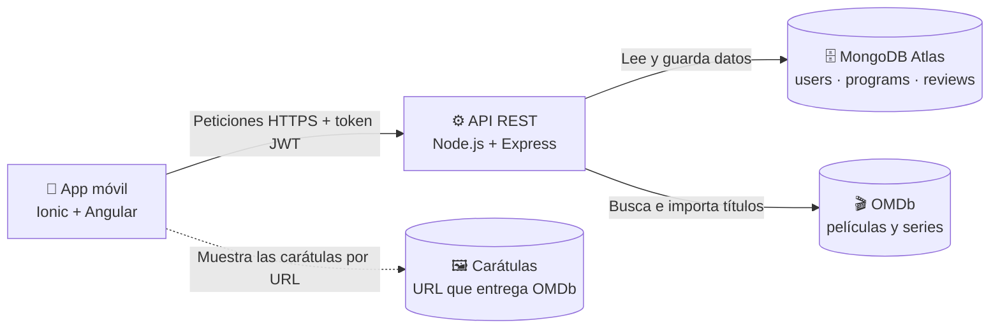

# SpoilerAlert 🎬

## Descripción

SpoilerAlert es una aplicación móvil para descubrir películas y series y leer o escribir reseñas sobre ellas, inspirada en Rotten Tomatoes.

La primera pantalla es el inicio de sesión. Cada usuario puede:

- Registrarse, iniciar sesión, editar su perfil y borrar su cuenta.
- En **Home**, ver las pestañas de **películas** y **series**, buscarlas por nombre, filtrarlas por categoría, año, puntaje de usuarios normales y puntaje de críticos, y ordenarlas por fecha o por puntaje. Por defecto se ordenan de la más nueva a la más vieja.
- Ver la ficha de cada título: sinopsis, fecha de estreno, actores, carátula, categorías, duración (películas) o temporadas (series) y sus puntajes.
- Escribir una reseña por título, con un puntaje del 1 al 100 (que se muestra de 1 a 5 estrellas) y un comentario opcional, y luego editarla o borrarla.
- Leer las reseñas de los demás, separadas en **críticos** y **audiencia**, y abrir el perfil público de cada autor: username, fecha de registro, tipo, cantidad de reseñas y promedio de puntos dados.

Hay tres tipos de usuario:

- **Normal:** el tipo de toda cuenta nueva.
- **Critic:** igual que un usuario normal, pero sus reseñas cuentan en el promedio de críticos.
- **Admin:** se crea directamente en la base de datos. Tiene un módulo extra, **Users**, para convertir usuarios normales en críticos y viceversa.

Cada título muestra **dos puntajes**: el promedio de los críticos y el promedio de los usuarios normales. Las películas y series no se crean ni se editan desde la app: se traen de OMDb.

La app está **en inglés**; esta documentación, en español.

Las películas y series vienen de la API de **OMDb**. Cuando alguien busca un título que todavía no está en la base de datos, la API lo trae de OMDb y lo guarda.

---

## Arquitectura

- **App móvil** (`frontend/`): Ionic + Angular, empaquetada con Capacitor. Habla solo con la API; nunca accede directamente a la base de datos ni a OMDb.
- **API REST** (`backend/`): Node.js + Express. Autentica con JWT, aplica las reglas de negocio, valida los datos y es la única que consulta OMDb.
- **MongoDB Atlas**: guarda usuarios, títulos y reseñas. Las categorías, los actores y los promedios viven dentro de cada título.
- **OMDb**: fuente de las películas y series. La API guarda una copia de cada título que importa, junto con la URL de su carátula; la app muestra la imagen directamente desde esa URL.

---

## Documentación

| Documento | Contenido |
| --------- | --------- |
| [`backend/README.md`](backend/README.md) | Stack, arquitectura, endpoints y cómo ejecutar la API. |
| [`backend/docs/DESIGN.md`](backend/docs/DESIGN.md) | Diseño de la base de datos en MongoDB. |
| [`frontend/README.md`](frontend/README.md) | Stack, arquitectura, pantallas y cómo ejecutar la app móvil. |
| [Mockups (Claude Design)](https://claude.ai/artifact/NauHvj9gkJR2MzXVXn4ofF) | Mockups interactivos de todas las pantallas. |

---

## Créditos

Los datos de películas y series provienen de [OMDb API](https://www.omdbapi.com/).

---

### Proyecto realizado por:
- Marielv Mavárez
- Mariángeles Mavárez

Para la materia Programación de Dispositivos Móviles de la Universidad Rafael Urdaneta.
