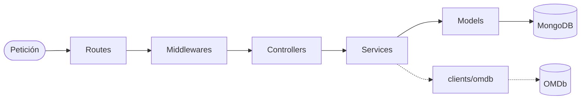

# SpoilerAlert — Backend

API REST de SpoilerAlert: usuarios, películas y series (programas) y reseñas.
Diseño de la base de datos: [`docs/DESIGN.md`](docs/DESIGN.md)

---

## Stack

| Capa          | Tecnología                               |
| ------------- | ---------------------------------------- |
| Runtime       | Node.js (≥ 22)                           |
| Framework     | Express 5                                |
| Base de datos | MongoDB (Atlas) + Mongoose               |
| Autenticación | JWT + bcrypt                             |
| Validación    | zod                                      |
| API externa   | OMDb (con el `fetch` nativo de Node)     |

---

## Arquitectura



| Carpeta (`src/`) | Responsabilidad                                                        |
| ---------------- | ---------------------------------------------------------------------- |
| `routes`         | Endpoints y sus middlewares.                                           |
| `middlewares`    | Autenticación, permisos por tipo de usuario, validación y errores.     |
| `schemas`        | Validación de los datos de entrada (zod).                              |
| `controllers`    | Reciben la petición y devuelven la respuesta.                          |
| `services`       | Lógica de negocio: importación desde OMDb, promedios, permisos.        |
| `models`         | Modelos de Mongoose.                                                   |
| `clients`        | Cliente de OMDb. Es el único lugar que llama a la API externa y traduce sus respuestas. |
| `constants`      | Enums, códigos de error, estados HTTP, reglas de campos y mapa de géneros de OMDb. Los que usa el frontend se copian tal cual. |
| `config`, `utils` | Configuración y funciones compartidas.                                |
| `scripts`        | `seed.js` y `seed-titles.json`: importa una lista inicial de títulos.  |

---

## Endpoints

Base: `/api/v1`. Todas las respuestas son JSON.

### Convenciones

- **Sesión:** todas las rutas, salvo registro e inicio de sesión, piden el header `Authorization: Bearer <token>`. El token dura 7 días.
- **Listas:** devuelven `{ data, page, limit, total }`. Por defecto `limit = 20` (máximo 50).
- **Errores:** devuelven `{ error: { code, message, details? } }`. El frontend debe usar `code` (estable), nunca `message`. Los códigos están en `src/constants/errorCodes.js`:

  | HTTP  | `code`             | Cuándo | `details` |
  | ----- | ------------------ | ------ | --------- |
  | `400` | `VALIDATION_ERROR` | Datos inválidos (zod) | `[{ path, message }]`, uno por campo inválido |
  | `400` | `BAD_REQUEST`      | Petición mal formada (por ejemplo, JSON inválido) | — |
  | `401` | `UNAUTHORIZED`     | Sin sesión, token inválido o vencido, o login incorrecto | — |
  | `403` | `FORBIDDEN`        | Sin permiso | — |
  | `404` | `NOT_FOUND`        | No existe | — |
  | `409` | `CONFLICT`         | Duplicado (email, username o segunda reseña del mismo título) | `{ fields: [...] }`, los campos duplicados |
  | `500` | `INTERNAL_ERROR`   | Error inesperado del servidor | — |
- **Acceso** (columna de las tablas):
  - **Público**: sin sesión.
  - **Usuario**: cualquier sesión (`normal`, `critic` o `admin`).
  - **Dueño**: el autor de la reseña.
  - **Admin**: `type = admin`.

### Auth

| Método | Ruta             | Acceso  | Descripción |
| ------ | ---------------- | ------- | ----------- |
| POST   | `/auth/register` | Público | Crea una cuenta con `type = normal`: `{ username, email, password }`. Responde `201 { token, user }`. Si se envía `type`, se ignora. |
| POST   | `/auth/login`    | Público | `{ login, password }`, donde `login` es el username o el email. Responde `200 { token, user }`. |
| GET    | `/auth/me`       | Usuario | Responde `{ user }`: el usuario de la sesión, con su email. |

Las reglas de `username`, `email` y `password` están en [`DESIGN.md`](docs/DESIGN.md#reglas-de-los-campos).

### Usuarios

| Método | Ruta                  | Acceso  | Descripción |
| ------ | --------------------- | ------- | ----------- |
| PATCH  | `/users/me`           | Usuario | Edita la propia cuenta: `username`, `email` y/o `password`. |
| DELETE | `/users/me`           | Usuario | Borra la propia cuenta y sus reseñas, y recalcula los promedios afectados. |
| GET    | `/users/:id`          | Usuario | Perfil público: `{ username, type, createdAt, reviewsCount, pointsMean }`. Nunca devuelve el email. |
| GET    | `/users/:id/reviews`  | Usuario | Reseñas del usuario, de la más reciente a la más antigua. |
| GET    | `/users`              | Admin   | Lista para el módulo **Users**: `username`, `email`, `type`, `createdAt` y `reviewsCount`. Filtros: `q` (username o email), `type`, `page`, `limit`. |
| PATCH  | `/users/:id/type`     | Admin   | `{ type: 'normal' \| 'critic' }`. Recalcula los promedios de los títulos que ese usuario reseñó. No permite crear admins ni cambiar a un admin. |

`reviewsCount` y `pointsMean` se calculan al pedirlos, con una agregación sobre `reviews`; no se guardan en `users`.

### Programas (películas y series)

No hay creación, edición ni borrado de programas: solo se leen, y se traen de OMDb cuando faltan.

| Método | Ruta               | Acceso  | Descripción |
| ------ | ------------------ | ------- | ----------- |
| GET    | `/programs`        | Usuario | Lista de una pestaña (*Movies* o *Series*) con búsqueda, filtros y orden (parámetros abajo). Si hay `q`, primero importa de OMDb los títulos que falten. |
| GET    | `/programs/:id`    | Usuario | Ficha completa. La primera vez que se abre, completa los detalles desde OMDb. |

Parámetros de `GET /programs`:

| Parámetro     | Valores                                    | Descripción |
| ------------- | ------------------------------------------ | ----------- |
| `type`        | `movie` \| `series`                        | Pestaña. Obligatorio. |
| `q`           | texto                                      | Busca por título. |
| `genres`      | valores de `Genre` separados por coma      | Títulos que tengan **al menos uno** de esos géneros. |
| `yearFrom`, `yearTo` | año                                 | Rango de año de estreno. |
| `minCritics`  | 0–100                                      | Promedio mínimo de críticos. |
| `minAudience` | 0–100                                      | Promedio mínimo de usuarios normales. |
| `sort`        | `newest` (default) \| `oldest` \| `critics` \| `audience` | Orden. `newest` y `oldest` usan `year` y luego `releaseDate`; `critics` y `audience`, el promedio de mayor a menor. |
| `page`, `limit` | número                                   | Paginación. |

### Reseñas

| Método | Ruta                          | Acceso  | Descripción |
| ------ | ----------------------------- | ------- | ----------- |
| GET    | `/programs/:id/reviews`       | Usuario | Reseñas del título, de la más reciente a la más antigua. `group=critics` (autores `critic`) o `group=audience` (autores `normal` y `admin`); `page`, `limit`. |
| GET    | `/programs/:id/reviews/mine`  | Usuario | La reseña del usuario de la sesión para ese título, o `404` si no tiene. |
| POST   | `/programs/:id/reviews`       | Usuario | Crea la reseña: `{ points, comment? }`. `points` entero 1–100; `comment` opcional, hasta 300 caracteres. Una por usuario y título (`409` si ya existe). |
| PATCH  | `/reviews/:id`                | Dueño   | Edita `points` y/o `comment`. |
| DELETE | `/reviews/:id`                | Dueño   | Borra la reseña. |

Cada vez que se crea, edita o borra una reseña, el servicio recalcula `pointsMeanNormal` y `pointsMeanCritics` del programa (ver [`DESIGN.md`](docs/DESIGN.md#puntajes)).

---

## Importación desde OMDb

La API nunca filtra ni ordena directamente sobre OMDb: primero guarda los títulos en MongoDB y después consulta su propia base. Así los filtros por puntaje de usuarios funcionan.

1. **Búsqueda** (`GET /programs?q=...`, solo en la página 1): llama a OMDb con `?s=<q>&type=<movie|series>`, descarta lo que no sea película o serie, y guarda los títulos nuevos con un *upsert* por `externalId`. La búsqueda de OMDb solo trae título, año, tipo, id y carátula, así que se guarda eso y `synopsis` queda en `null`. Los títulos que ya existen no se tocan.
2. **Consulta local**: aplica los filtros y el orden sobre la colección `programs` y responde.
3. **Ficha** (`GET /programs/:id`): si `synopsis` es `null` (solo tiene los datos de la búsqueda), pide el detalle a OMDb con una sola petición, `?i=<imdbId>&plot=full`. Con eso completa fecha, sinopsis, categorías, actores, y duración o temporadas.
4. **Si OMDb falla** o se agotó el cupo, la API responde con lo que ya tiene guardado; no devuelve error.

Peticiones a OMDb (base `https://www.omdbapi.com/`, siempre con `apikey`):

| Petición | Para qué |
| -------- | -------- |
| `?s=<texto>&type=<movie\|series>&page=1` | Búsqueda por nombre. Devuelve hasta 10 resultados. |
| `?i=<imdbId>&plot=full` | Detalle de una película o serie. |

### Cupo diario

La clave gratuita de OMDb permite **1.000 peticiones al día**. Cada búsqueda gasta 1 y cada ficha abierta por primera vez gasta 1; después todo sale de MongoDB. Por eso:

- Solo se consulta OMDb en la página 1 de una búsqueda con `q`, y nunca para los filtros.
- El detalle se pide una sola vez por título.
- OMDb no tiene lista de "populares", así que el `seed` importa los títulos de `scripts/seed-titles.json` (una lista de ids de IMDb).

### Traducción de datos

OMDb devuelve todo como texto y usa `"N/A"` cuando falta un dato. `clients/omdb` lo convierte antes de guardar:

| Dato de OMDb | Se guarda como |
| ------------ | -------------- |
| `"N/A"` en cualquier campo | `null` |
| `Year`: `"2010"` o `"2008–2013"` | `year`: el primer año, como número. |
| `Released`: `"16 Jul 2010"` | `releaseDate`: `Date`. |
| `Runtime`: `"148 min"` | `durationMin`: `148` (solo películas). |
| `totalSeasons`: `"5"` | `seasonsCount`: `5`. |
| `Genre`: `"Action, Sci-Fi"` | `genres`: `['action', 'science_fiction']`, con `OMDB_GENRE_MAP`. |
| `Actors`: `"Leonardo DiCaprio, Elliot Page"` | `actors`: `['Leonardo DiCaprio', 'Elliot Page']`. |

La app está en inglés, así que los textos de OMDb (título, sinopsis, actores) se guardan y se muestran tal cual, sin traducir.

---

## Variables de entorno

| Variable          | Ejemplo                    | Descripción |
| ----------------- | -------------------------- | ----------- |
| `PORT`            | `3000`                     | Puerto de la API. Opcional (default `3000`). |
| `HOST`            | `127.0.0.1`                | Interfaz donde escucha la API. Opcional (default `127.0.0.1`). Usar `0.0.0.0` solo si un celular/emulador en la red debe llegar a la API. |
| `MONGODB_URI`     | `mongodb+srv://...`        | Cadena de conexión de MongoDB Atlas, con el nombre de la base antes del `?`. |
| `DNS_SERVERS`     | `1.1.1.1`                  | Opcional. Servidores DNS para Node, separados por coma. Solo si la conexión a Mongo falla con `querySrv ETIMEOUT`. |
| `JWT_SECRET`      | texto largo y aleatorio    | Clave para firmar los tokens. |
| `JWT_EXPIRES_IN`  | `7d`                       | Duración del token. |
| `OMDB_API_KEY`    | `a1b2c3d4`                 | Clave de OMDb. |
| `CORS_ORIGIN`     | `http://localhost:8100,http://localhost` | Orígenes permitidos: `ionic serve` y la app de Android en desarrollo. |

---

## Crear el administrador

La app nunca crea administradores: el admin, y los datos de usuarios de prueba, se crean **directamente en MongoDB**.

**Forma recomendada:** registrar el usuario con `POST /auth/register` (así su email, username y contraseña pasan las mismas validaciones que cualquier cuenta) y después, en MongoDB Atlas → *Collections* → `users`, editar el documento y cambiar `type` a `"admin"` (o `"critic"`), en minúsculas.

**Forma manual** (sin la API levantada):

1. Generar el hash de la contraseña (dentro de `backend/`, con las dependencias instaladas). Usar costo `12`, el mismo que la app:
   ```bash
   node -e "console.log(require('bcrypt').hashSync('TuClaveSegura', 12))"
   ```
2. Insertar el usuario con `mongosh` (o desde MongoDB Atlas → *Collections* → `users` → *Insert document*):
   ```js
   db.users.insertOne({
     username: "admin",
     email: "admin@spoileralert.com",
     passwordHash: "<hash del paso 1>",
     type: "admin",
     createdAt: new Date(),
     updatedAt: new Date()
   })
   ```

Los usuarios de prueba se insertan igual, con `type: "normal"` o `type: "critic"`. Un documento insertado a mano no pasa por las validaciones de la app: el email debe ir en minúsculas, el username debe cumplir sus reglas y `type` debe ser exactamente `normal`, `critic` o `admin`.

---

## Cómo ejecutar

1. Dentro de `backend/`: `pnpm install`.
2. Copiar `.env.example` a `.env` y completar los valores. La clave de OMDb se pide gratis en omdbapi.com → *API Key* y llega por email.
3. `pnpm seed` → importa los títulos de `seed-titles.json`.
4. Crear el administrador (ver arriba).
5. `pnpm dev` → la API queda en `http://localhost:3000/api/v1`.
