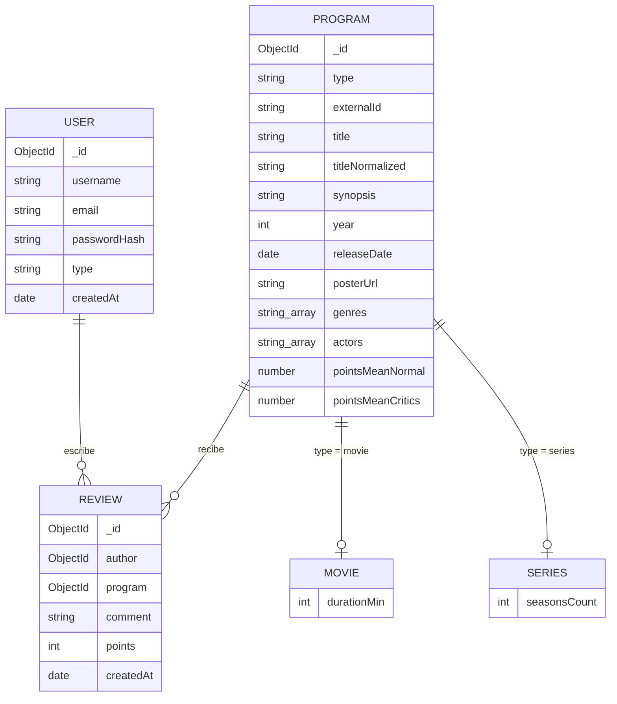

# SpoilerAlert — Diseño de la base de datos

Base de datos **MongoDB** (Atlas), accedida con **Mongoose**. Tres colecciones: `users`, `programs` y `reviews`.
Todas incluyen `createdAt` y `updatedAt` automáticos.

---

## Diagrama

Películas y series comparten la colección `programs`. El campo `type` funciona como **discriminador** de Mongoose: cada documento tiene los campos comunes más el de `MOVIE` o el de `SERIES`, según su tipo. Los géneros y los actores se guardan **dentro** de cada programa, como listas. Usuarios, programas y reseñas se relacionan por `ObjectId`.

---

## Entidades

### User — colección `users`

| Campo          | Tipo       | Descripción |
| -------------- | ---------- | ----------- |
| `username`     | String     | Nombre de usuario. Único. |
| `email`        | String     | Correo de acceso. Único, en minúsculas. Solo lo ve su dueño. |
| `passwordHash` | String     | Clave hasheada con bcrypt. Nunca se devuelve. |
| `type`         | `UserType` | `normal` (default) \| `critic` \| `admin`. |
| `createdAt`    | Date       | Fecha de registro. Se muestra en el perfil público. |

#### Tipos de usuario

| Tipo     | Cómo se obtiene | Qué puede hacer |
| -------- | --------------- | --------------- |
| `normal` | Al registrarse en la app. | Ver títulos, escribir, editar y borrar sus reseñas, y editar o borrar su cuenta. |
| `critic` | Un admin lo asigna desde el módulo **Users**. | Lo mismo que `normal`. Sus reseñas cuentan en el promedio de críticos. |
| `admin`  | Se crea **directamente en MongoDB** (ver [`backend/README.md`](../README.md#crear-el-administrador)). La app nunca crea admins. | Lo mismo que `normal`, más el módulo **Users** para cambiar a otros usuarios entre `normal` y `critic`. |

Las reseñas de un `admin` cuentan en el promedio de usuarios normales.

### Program — colección `programs`

| Campo               | Tipo           | Descripción |
| ------------------- | -------------- | ----------- |
| `type`              | `ProgramType`  | `movie` \| `series`. Discriminador. |
| `externalId`        | String         | Id de IMDb que entrega OMDb (ej. `tt1375666`). Único. Permite saber si el título ya está guardado. |
| `title`             | String         | Título. |
| `titleNormalized`   | String         | Título en minúsculas y sin acentos. Uso interno: búsqueda. |
| `synopsis`          | String \| null | Sinopsis. `null` mientras solo se tienen los datos de la búsqueda. |
| `year`              | Number         | Año de estreno (en series: el primer año). La búsqueda de OMDb solo trae el año; se usa para el filtro y el orden por fecha. |
| `releaseDate`       | Date \| null   | Fecha exacta de estreno. Se completa al abrir la ficha. |
| `posterUrl`         | String \| null | URL de la carátula que entrega OMDb. |
| `genres`            | [`Genre`]      | Categorías del título. |
| `actors`            | [String]       | Actores principales, en el orden en que los entrega OMDb. |
| `pointsMeanNormal`  | Number \| null | Promedio de las reseñas de usuarios normales (y admins). `null` si no hay. |
| `pointsMeanCritics` | Number \| null | Promedio de las reseñas de críticos. `null` si no hay. |

#### Campo de película — `type = movie`

| Campo         | Tipo           | Descripción |
| ------------- | -------------- | ----------- |
| `durationMin` | Number \| null | Duración en minutos. |

#### Campo de serie — `type = series`

| Campo          | Tipo           | Descripción |
| -------------- | -------------- | ----------- |
| `seasonsCount` | Number \| null | Número de temporadas. |

### Review — colección `reviews`

| Campo     | Tipo                  | Descripción |
| --------- | --------------------- | ----------- |
| `author`  | ObjectId → `users`    | Autor de la reseña. |
| `program` | ObjectId → `programs` | Título reseñado. |
| `comment` | String \| null        | Opinión. **Opcional**, hasta 300 caracteres. |
| `points`  | Number                | Puntaje entero del 1 al 100. |

Una reseña por usuario y título. Para mostrar el nombre y el tipo del autor se usa `populate('author', 'username type')`.

#### Estrellas

Las estrellas no se guardan: la app las calcula a partir de `points` con `Math.ceil(points / 20)`.

| `points` | Estrellas |
| -------- | --------- |
| 1–20     | ★ |
| 21–40    | ★★ |
| 41–60    | ★★★ |
| 61–80    | ★★★★ |
| 81–100   | ★★★★★ |

---

## Enums

Se definen en `src/constants/enums.js` y se copian tal cual en el frontend, para que los filtros siempre coincidan con lo que acepta la base. Se guardan **claves estables** (`science_fiction`); la app, que está en inglés, muestra una etiqueta legible ("Sci-Fi").

| Enum          | Valores |
| ------------- | ------- |
| `UserType`    | `normal` \| `critic` \| `admin` |
| `ProgramType` | `movie` \| `series` |
| `Genre`       | `action` \| `adventure` \| `animation` \| `biography` \| `comedy` \| `crime` \| `documentary` \| `drama` \| `family` \| `fantasy` \| `history` \| `horror` \| `music` \| `mystery` \| `reality` \| `romance` \| `science_fiction` \| `sport` \| `thriller` \| `war` \| `western` \| `other` |

### Traducción desde OMDb

| Dato de OMDb | Regla |
| ------------ | ----- |
| `Genre` | Se traduce cada nombre con `OMDB_GENRE_MAP`: *Sci-Fi* → `science_fiction`; *Musical* → `music`; *Film-Noir* → `crime`; *Reality-TV* → `reality`; el resto, por su nombre en minúsculas (*Action* → `action`). *Short*, *News*, *Talk-Show*, *Game-Show* o cualquier nombre desconocido → `other`. |
| `Type` | `movie` → `movie`; `series` → `series`. `episode` y `game` se descartan. |

---

## Puntajes

`pointsMeanNormal` y `pointsMeanCritics` se guardan en cada programa para poder filtrar y ordenar por puntaje sin recalcular en cada búsqueda. Se **recalculan** con una agregación sobre las reseñas del programa, uniendo cada reseña con el `type` de su autor: `critic` cuenta en `pointsMeanCritics`; `normal` y `admin`, en `pointsMeanNormal`. Se recalculan cada vez que:

| Evento | Qué se recalcula |
| ------ | ---------------- |
| Se crea, edita o borra una reseña | Los dos promedios de ese programa. |
| Un admin cambia el `type` de un usuario | Los promedios de todos los programas que ese usuario reseñó. |
| Se borra un usuario | Los promedios de todos los programas que ese usuario reseñó. |

Un promedio queda en `null` si su grupo no tiene reseñas.

### Estadísticas del perfil público

El perfil de un usuario muestra **cantidad de reseñas** y **promedio de puntos dados**. No se guardan: se calculan al pedir el perfil, con una agregación sobre sus reseñas (`count` y `avg` de `points`).

---

## Borrado

MongoDB no borra en cascada; lo hace la API:

- **Borrar una cuenta:** se borran sus reseñas, luego el usuario, y se recalculan los promedios de los programas afectados.
- **Borrar una reseña:** se borra y se recalculan los promedios de su programa.
- Los **programas** no se borran desde la app: son una copia de OMDb y otras reseñas dependen de ellos.

---

## Índices

| Colección  | Índice                                              | Para qué |
| ---------- | --------------------------------------------------- | -------- |
| `users`    | `{ email: 1 }` único, `{ username: 1 }` único       | No hay cuentas repetidas. |
| `programs` | `{ externalId: 1 }` único                           | No importar dos veces el mismo título. |
| `programs` | `{ type: 1, year: -1, releaseDate: -1 }`            | Pestañas Movies / Series ordenadas de la más nueva a la más vieja. |
| `programs` | `{ titleNormalized: 1 }`, `{ genres: 1 }`           | Búsqueda por nombre y filtro por categoría. |
| `programs` | `{ pointsMeanNormal: -1 }`, `{ pointsMeanCritics: -1 }` | Orden y filtro por puntaje. |
| `reviews`  | `{ author: 1, program: 1 }` único                   | Una reseña por usuario y título. |
| `reviews`  | `{ program: 1, createdAt: -1 }`                     | Reseñas de un título. |
| `reviews`  | `{ author: 1, createdAt: -1 }`                      | Reseñas y estadísticas de un usuario. |
