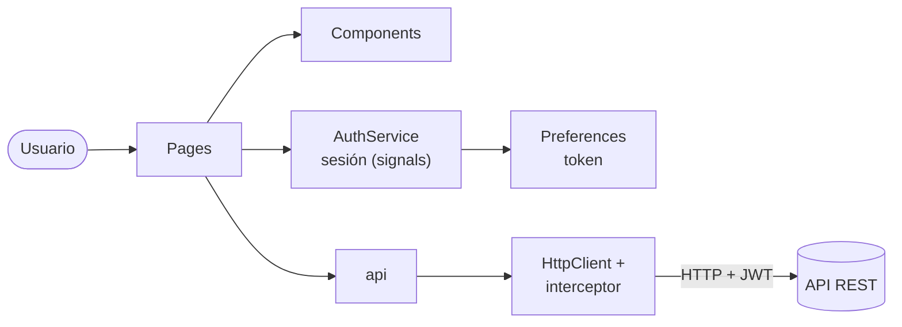

# SpoilerAlert — Frontend

App móvil de SpoilerAlert, hecha con Ionic + Angular y empaquetada con Capacitor. Consume la API del [`backend/`](../backend/README.md).
Mockups interactivos: [SpoilerAlert — Mockups](https://claude.ai/artifact/NauHvj9gkJR2MzXVXn4ofF) (Claude Design).

---

## Stack

| Capa               | Tecnología                                         |
| ------------------ | -------------------------------------------------- |
| Framework          | Ionic 9 + Angular 22 (componentes *standalone*)    |
| Lenguaje           | TypeScript                                         |
| App nativa         | Capacitor 8 (Android)                              |
| Navegación         | Angular Router + pestañas de Ionic (`ion-tabs`)    |
| Estado             | Signals de Angular                                 |
| HTTP               | `HttpClient` + interceptor que añade el JWT        |
| Sesión             | JWT guardado con `@capacitor/preferences`          |
| Fuentes            | Bebas Neue (títulos) y Manrope (texto), de Google Fonts |
| Gestor de paquetes | pnpm                                               |

---

## Cómo ejecutar (Android por USB)

**Una vez:**

1. Instalar [Android Studio](https://developer.android.com/studio) (opciones por defecto, asistente *Standard*).
2. En el teléfono: activar el modo desarrollador (tocar 7 veces *Versión del SO*), y luego **Depuración USB** e **Instalar vía USB**.
3. Conectarlo por USB, elegir *Transferencia de archivos* y permitir la depuración USB.
4. En `frontend/`: `pnpm install`, `ionic build`, `pnpm add @capacitor/android` y `npx cap add android`.

**Cada vez que cambia el código:**

```bash
ionic build
npx cap sync android
npx cap run android
```

**API:** con el backend corriendo, ejecutar `adb reverse tcp:3000 tcp:3000` (de nuevo cada vez que se reconecta el teléfono). Así el teléfono llega a la API por el cable USB, con `apiUrl: 'http://localhost:3000/api/v1'` en `src/environments/environment.ts`.

---

## Arquitectura



Las páginas nunca usan `HttpClient` directamente: piden los datos a los servicios de `api`. `auth.interceptor.ts` es el único que añade el token; si la API responde `401`, cierra la sesión y lleva al login.

| Carpeta (`src/app/`) | Responsabilidad                                                        |
| -------------------- | ---------------------------------------------------------------------- |
| *(raíz)*             | Arranque: `app.component`, `app.routes.ts` y guards (`auth.guard.ts`, `admin.guard.ts`). |
| `pages`              | Pantallas. Una carpeta por ruta.                                       |
| `components`         | Piezas de UI (ver abajo), una carpeta por componente, sin subcarpetas. |
| `api`                | Llamadas al backend, un servicio por recurso (`auth`, `users`, `programs`, `reviews`), y `auth.interceptor.ts`. |
| `services`           | `AuthService`: sesión (signals) y token en Preferences.                |
| `models`             | Interfaces de las respuestas de la API y enums (copia de los del backend). |
| `constants`          | Etiquetas de los enums para la interfaz y límites fijos (puntaje 1–100, comentario 300). |
| `utils`              | Funciones puras: estrellas, fechas, imágenes de respaldo.              |

| Otras carpetas (`src/`) | Responsabilidad |
| ----------------------- | --------------- |
| `environments`          | URL de la API por entorno. Ubicación que exige Angular. |
| `theme`                 | Colores y variables de Ionic (`variables.scss`). Ubicación que exige Ionic. |

---

## Pantallas

La app tiene dos módulos para todos los usuarios, **Home** y **My profile**, y uno extra para el admin, **Users**. Para un usuario `normal` y un `critic` la app es igual: solo cambia el tipo que se muestra en su perfil.

| Ruta                    | Pantalla (título en la app) | Acceso  | Contenido |
| ----------------------- | --------------------------- | ------- | --------- |
| `/login`                | Log in / Sign up | Público | **Primera pantalla.** Una sola página con el selector *Log in / Sign up* (`account-entry-selector`). **Log in:** username o email y contraseña; el botón se activa cuando ambos campos tienen texto. **Sign up:** username, email, contraseña y confirmación; avisa si las contraseñas no coinciden y crea siempre un usuario `normal`. |
| `/tabs/home`            | Home            | Usuario | Pestañas **Movies** y **Series**. Buscador por nombre y panel de filtros: categoría, año (desde / hasta), puntaje mínimo de críticos, puntaje mínimo de audiencia y orden. Por defecto, de la más nueva a la más vieja. Películas y series usan la misma tarjeta. |
| `/programs/:id`         | Details         | Usuario | Todos los campos del programa: carátula, título, tipo, año, fecha de estreno, duración (películas) o temporadas (series), categorías, sinopsis y actores. Los dos promedios (críticos y audiencia) con estrellas. Reseñas separadas en *Critics* / *Audience*. Botón *Write a review*. |
| `/programs/:id/review`  | My review       | Usuario | Crear o editar la propia reseña: puntaje 1–100 con deslizador y estrellas en vivo, y comentario opcional (máx. 300). Al editar, permite borrarla. |
| `/users/:id`            | Profile         | Usuario | Perfil público (`UserProfilePage`), solo datos no sensibles: username, fecha de registro, tipo, cantidad de reseñas, promedio de puntos dados y sus reseñas. Cada reseña abre Details. |
| `/tabs/profile`         | My profile      | Usuario | `MyProfilePage`: mis datos (incluido mi email), tipo, estadísticas y mis reseñas con editar (mismo popup que Details) y borrar. Cerrar sesión, *Edit profile* (popup) y borrar cuenta. |
| *(popup en My profile)* | Edit profile    | Usuario | `edit-profile-sheet`, sin ruta propia: username, email y, opcionalmente, nueva contraseña con confirmación. Solo manda lo que cambió (`PATCH /users/me`). El tipo se muestra pero no se puede cambiar. |
| `/tabs/users`           | Users           | Admin   | `UsersViewPage`. Buscar usuarios por username o email, filtrar por tipo y cambiar a cada uno entre *Normal* y *Critic*. Los admins aparecen marcados y no se pueden cambiar. |

- Todas las rutas, salvo `/login`, usan `authGuard`. Sin sesión se va al login.
- La pestaña **Users** solo aparece si `type = admin`, y la ruta está protegida con `adminGuard`.
- Al tocar una reseña en Details se abre el perfil público de su autor (`/users/:id`); si es la propia, se abre *My profile*.
- **Toda la interfaz está en inglés**, igual que los datos de OMDb. Los enums se muestran con las etiquetas de `constants` (ej. `science_fiction` → "Sci-Fi").

### Puntajes y estrellas

- Las estrellas se calculan con `Math.ceil(points / 20)`: 1–20 = 1 estrella, 21–40 = 2, 41–60 = 3, 61–80 = 4, 81–100 = 5. Se usa la misma regla para las reseñas y para los promedios.
- Si un grupo no tiene reseñas, su promedio se muestra como "—".
- En las tarjetas, el puntaje de críticos lleva un icono de insignia y el de audiencia un icono de personas, para no depender solo del color.

---

## Componentes

| Componente        | Dónde se usa | Qué muestra |
| ----------------- | ------------ | ----------- |
| `button`          | Toda la app  | Botón reutilizable (`<app-button>`): variantes `primary`, `outline` y `danger`, icono opcional a la derecha. |
| `account-entry-selector` | Log in / Sign up | Selector *Log in / Sign up*; la página decide qué formulario mostrar. |
| `login-form`      | Log in / Sign up | Username o email y contraseña. Emite los datos con `(submitted)`. |
| `signup-form`     | Log in / Sign up | Username, email, contraseña y confirmación. Emite los datos con `(submitted)`. |
| `home-header`     | Home (y las otras pestañas) | Logo + título. `title` cambia el texto (por defecto "SpoilerAlert"). |
| `program-selector` | Home        | Selector *Movies / Series*: `[(type)]`. Mismos estilos que `account-entry-selector` (`.sa-segment` en `global.scss`). |
| `search-bar`      | Home, Users  | Buscador: `[(query)]` y `placeholder`, espera 350 ms después de la última tecla. Home busca programas por nombre; Users busca usuarios por username o email. |
| `search-filter`   | Home         | Botón con contador + popup (hoja inferior): orden, categorías (dropdown que va añadiendo chips), rango de años y estrellas mínimas de críticos y audiencia. `[(filters)]`; solo aplica al tocar *Apply*. |
| `active-filters`  | Home         | Debajo del buscador: un chip por filtro activo (orden, cada categoría, años, estrellas de críticos y de audiencia). La × de cada chip quita ese filtro; *Clear* vuelve a los valores por defecto. `[(filters)]`. |
| `program-card-simple` | Home, Details, My review, perfiles | Carátula de un programa: imagen de OMDb o recuadro de color con el título; icono de película o serie según `type`. `size="large" \| "small" \| "mini"`. `[showName]="false"` quita el título del recuadro (cuando el nombre ya está escrito al lado). |
| `program-home-card` | Home       | `program-card-simple` + título, año, dos primeras categorías y los dos promedios. |
| `program-detail-card` | Details  | `program-card-simple` pequeña + tipo, título y año · duración (película) o temporadas (serie). |
| `score-detail-card` | Details    | Un promedio: `group="critics"` (insignia roja, `pointsMeanCritics`) o `group="audience"` (personas amarillas, `pointsMeanNormal`). Número, estrellas y cantidad de reseñas. |
| `program-facts`   | Details      | Lista *Released* + *Duration* o *Seasons*. Omite las filas sin dato. |
| `chip-list`       | Details      | Fila de etiquetas con borde: las categorías. |
| `actor-list`      | Details      | Los actores, un `actor-chip` por cada uno. |
| `actor-chip`      | Details      | Un actor: círculo con su inicial + nombre. |
| `detail-section`  | Details      | Bloque con título (`heading`) y contenido libre entre las etiquetas: *Synopsis*, *Actors*. |
| `user-type-selector` | Details, Users | Selector de dos opciones, genérico: recibe `[options]` y `[(value)]`. En Details muestra *Critics / Audience* y **filtra** las reseñas; dentro de `user-view-card` muestra *Normal / Critic* y **cambia el tipo** del usuario. El componente solo emite `(valueChange)`: lo que pasa después lo decide quien lo usa. |
| `reviews-group-by-program` | Details | Las reseñas de un grupo (`review-details` × N), *Load more reviews* y mensajes de vacío / error. Cada reseña enlaza al perfil de su autor; con `myUserId`, la propia enlaza a *My profile*. Emite `(loadMore)` y `(retry)`. |
| `review-details`  | Details | Una reseña: avatar con inicial, username, insignia *Critic*, fecha, puntaje /100, estrellas y comentario si lo hay. |
| `my-review-sheet` | Details, My profile | Popup *Write a review* / *Edit review* (hoja inferior, como el de filtros) con `program-review-card`, `my-score-card` y `my-comment-section`. Al editar: *Delete review* y los botones *Cancel* + *Save changes*. No llama a la API: emite `(submitted)`, `(deleted)` y `(closed)`. |
| `program-review-card` | Write a review | `program-card-simple size="mini"` + título + "Movie · 2024 · 166 min" (sin duración si recibe un `ProgramSummary`). |
| `my-score-card`   | Write a review | *Your score*: número grande, estrellas en vivo, deslizador 1–100 y `score-stars`. `[(points)]`. |
| `score-stars`     | Write a review | La escala 1–20 … 81–100 = 1 … 5 estrellas, con la franja del puntaje actual resaltada. |
| `my-comment-section` | Write a review | Comentario opcional con contador 0/300 y aviso de a qué promedio cuenta según `userType` (critic → Critics; normal/admin → Audience). `[(comment)]`. |
| `star-rating`     | Details, filtros, My review, perfiles | Las 5 estrellas a partir de `points` (o directamente `stars`). |
| `tab-bar`         | Home, My profile, Users | Pestañas inferiores; *Users* solo si `showUsers` (admin). |
| `user-view-card`  | Users        | Un usuario: avatar con inicial, username (abre su perfil), email, *Since … · N reviews* y `user-type-selector` *Normal / Critic*. Los admins muestran *Admin · created in the database* en lugar del selector. No llama a la API: emite `(typeChange)`. |
| `user-filter`     | Users        | Chips *All / Normal / Critics*: `[(type)]` (`null` = All). |
| `edit-profile-sheet` | My profile | Popup *Edit profile* (hoja inferior, como el de filtros): username, email, nueva contraseña + confirmación y el tipo (solo lectura). Emite `(submitted)` solo con los campos que cambiaron, y `(closed)`. |
| `user-type-badge` | Perfiles, Users | Insignia *Normal user* (gris), *Critic* (roja) o *Admin* (amarilla). `[showIcon]` añade el icono de insignia. |
| `my-profile-info` | My profile   | Avatar con inicial, username, `user-type-badge`, *Member since* y el email (*Only you can see your email*). |
| `user-profile-info` | Profile    | Lo mismo centrado y sin email: avatar, username, `user-type-badge` con icono y *Member since*. |
| `profile-reviews-card` | My profile, Profile | Recuadro *Reviews*: cantidad de reseñas del usuario. |
| `profile-points-card` | My profile, Profile | Recuadro *Avg. points given*: promedio de puntos /100, o "—" sin reseñas. |
| `my-profile-program-card` | My profile | Una reseña propia: `program-card-simple size="mini" [showName]="false"` + título (enlace a Details), "Movie · 2024", puntaje y estrellas. Botones editar y borrar: emite `(edit)` y `(delete)`. |
| `user-program-card` | Profile    | Una reseña de otro usuario: `program-card-simple size="mini" [showName]="false"` + título, "Movie · 2024", puntaje /100, estrellas y comentario. La página la enlaza a Details. |

---

## Diseño

Los mockups de todas las pantallas están en [Claude Design](https://claude.ai/artifact/NauHvj9gkJR2MzXVXn4ofF), con navegación entre pantallas. Valores base para `theme/variables.scss`:

| Token          | Valor     | Uso |
| -------------- | --------- | --- |
| Fondo          | `#0F0B0B` | Fondo de todas las pantallas. |
| Superficie     | `#1A1414` | Tarjetas, campos y paneles. |
| Barra inferior | `#140F0F` | Tab bar y botones fijos. |
| Acento         | `#DB3125` | Botones principales y pestaña activa. |
| Acento texto   | `#FF5A4D` | Enlaces y textos en rojo sobre fondo oscuro. |
| Estrellas      | `#F5B83D` | Estrellas e icono de audiencia. |
| Texto          | `#F4EFEC` | Texto principal. |
| Texto suave    | `#A8A09C` | Etiquetas y datos secundarios. |

### Estilo *liquid glass*

Tarjetas, campos, selectores, botones, popups y la barra de pestañas son de **vidrio translúcido**: dejan ver borroso lo que hay detrás, con un borde claro arriba (como iOS). Todo se ajusta desde los tokens `--sa-glass-*` de `theme/variables.scss`:

| Token | Uso |
| ----- | --- |
| `--sa-glass-bg`, `--sa-glass-border`, `--sa-glass-shadow`, `--sa-glass-blur` | El vidrio de tarjetas y campos: fondo degradado translúcido, borde, brillo superior + sombra, y desenfoque. |
| `--sa-glass-bg-soft` | Piezas pequeñas dentro de una tarjeta: chips y botones de ícono. |
| `--sa-glass-bar` | Vidrio más opaco: barra de pestañas flotante, pie fijo de Details y popups. |
| `--sa-glass-accent`, `--sa-glass-accent-shadow` | Vidrio rojo: botón principal y opción seleccionada de los selectores. |
| `--sa-glass-accent-soft` | Chips seleccionados y pestaña activa. |
| `--sa-glass-focus` | Anillo rojo alrededor del campo con foco. |

- El vidrio necesita color detrás: `global.scss` pone en `ion-content` unas luces suaves (rojo, ámbar y ciruela) sobre el fondo oscuro.
- Clases globales: `.sa-field` (campos), `.sa-segment` (selectores), `.sa-sheet` (popups inferiores) y `.sa-glass` (cualquier panel).
- La barra de pestañas flota sobre el contenido; las pestañas dejan espacio al final del scroll (`app-tabs ion-content` en `global.scss`).
- Si un teléfono viejo va lento al hacer scroll, el desenfoque se apaga en un solo sitio: `--sa-glass-blur: none;`.
